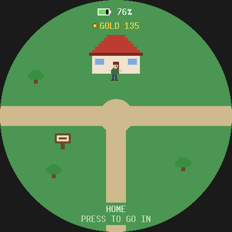
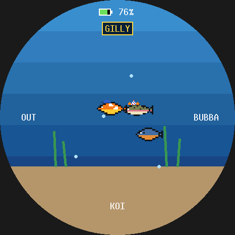
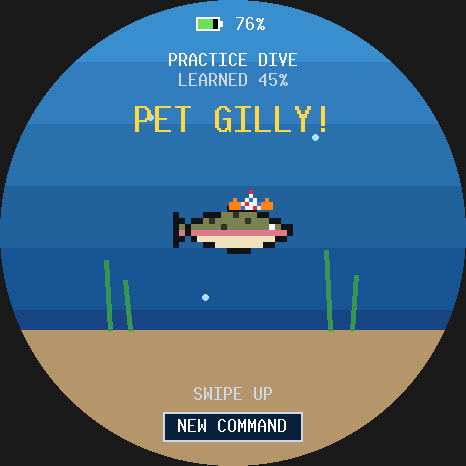
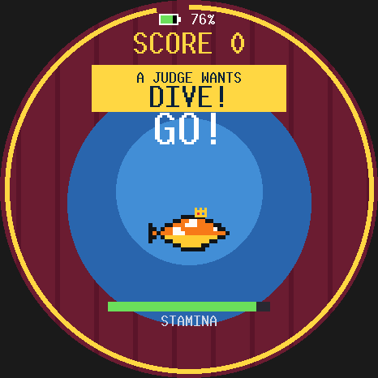
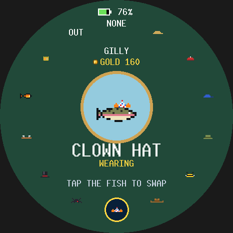
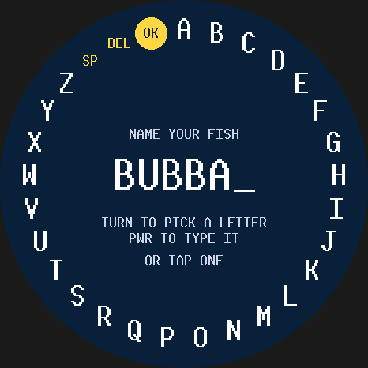
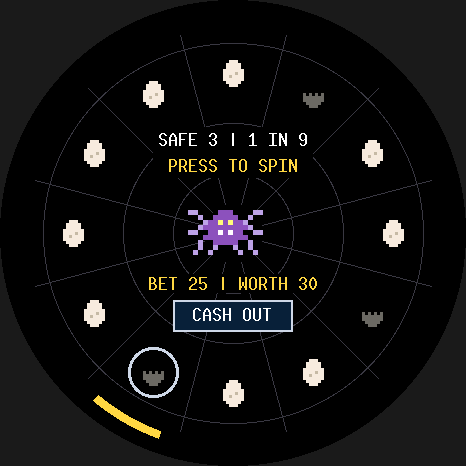
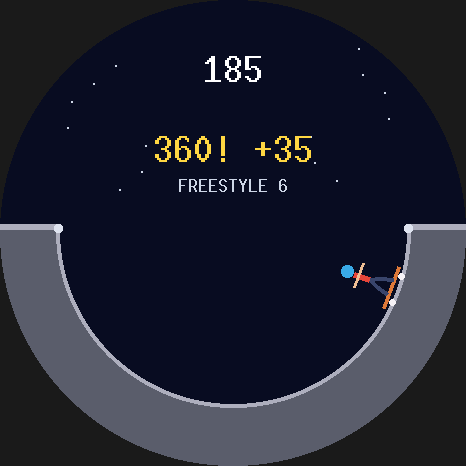
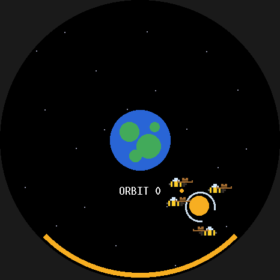

# Orbit board games: Fish Pals

`no_std` **Bevy 0.19** games for the Waveshare **ESP32-S3-Touch-AMOLED-1.75**
(466x466 round AMOLED, CO5300 over QSPI, CST9217 touch, QMI8658 IMU, two buttons).
Turning the device like a steering wheel is the main control everywhere; a press of the
upper button confirms.

**Fish Pals** is what the board boots into: a Nintendogs-style game about the fish you
catch.

- **The town:** six little round clearings joined by paths. Tap where to go (or hold a
  finger down and you follow it), tap the end of a path to go down it, and press the upper
  button at a door.
  The signpost by your house has the settings: sound, MOCK WALK, and a reset.
- **The pond** (Angler, the fishing game):
  - **Aim and cast:** turn like a steering wheel. A dotted line shows where a full-power
    cast lands; hold the upper button and release at the top of the meter to land exactly
    on it.
  - **Fight:** lean forward and back to keep the fish inside the catch zone, as in Stardew
    Valley.
  - **Keep:** KEEP a catch (or RELEASE it) and name it by turning on a ring of letters. You
    can keep three; a full tank asks who goes back. The fish log and difficulty are saved.
  - **GUTEN:** in Angler's settings, a riff on logic-fish where a rainbow trout spins to
    "Guten Morgen, Sonnenschein".
- **Home:** your fish swim in the tank wearing their hats. Each has a card (species, size,
  stamina, appeal) and five tricks of varying rarity, from SPLASH to RAINBOW LEAP.
  - **Teach a trick:** watch it, then say a word twice into the board's mics, or draw a
    stroke on the glass twice (tap, hold, swipe, circle). The two takes of a word have to
    sound alike, and the fish gets used to your voice as you use it.
  - **Practise:** give the command; pet the fish right after it gets one right and it
    learns twice as fast.
- **The park:** take a fish for a walk to build its stamina. The -G board's GPS counts the
  metres you really walk (not standing still, not in a car); MOCK WALK strolls on its own,
  at x1 up to x25 (tap it in the settings to go faster, or - and + during the walk).
- **The contest hall:** a 30-second show in four tiers (more stamina unlocks the higher
  ones).
  - Give your commands live: rarer, better-known tricks score more, changing it up adds a
    combo, and a trick the judges call for counts double.
  - Each try tires the fish. Its looks (rarity, size, hat) add appeal, and the top three
    win gold.
- **The hat shop:** a ring of 12 hats (beanie, cowboy hat, clown hat, a crown...); the
  mirror shows your fish wearing the one you point at.
- **The den:** Spider Roulette as a gamble.
  - Bet gold, then a press spins a pointer round twelve eggs, one of which hides a spider.
  - Each safe egg raises what the bet is worth, and CASH OUT banks it. If the spider
    pounces, the bet is gone.
- **The arcade cabinet:** Skate, a night-street side-scroller.
  - Turn left to ollie and level out to land; grind the benches.
  - Every 150 m the street drops into a halfpipe for a 7 s freestyle of spins.
- **A humming tree:** Bees???. The Moon is a hollow jar of honey orbiting the Earth; turn to
  keep it from spilling while bees (in your lead fish's hat) fly refills up.
- **Everywhere:** hold BOOT 3 s and the board says GOOD NIGHT and deep-sleeps; press BOOT to
  wake. After 30 s untouched the panel dims. Everything persists in one flash record, a
  section per app.
- **Orbit**, circular pong (touch), is its own firmware binary.

The same Bevy apps run in a desktop simulator and on the board, and both draw
through the same software renderer, so the simulator shows the exact pixels the
panel will get.

  
  
  

```
crates/orbit_gfx     no_std rasterizer (embedded-graphics + pixel-art sprites), dirty rects, bands
crates/orbit_motion  no_std IMU fusion (Mahony) with zeroing -> steer/lean
crates/orbit_save    no_std power-fail-safe flash records
crates/orbit_audio   no_std PCM clips + mixer, and voice prints for spoken commands
crates/orbit_core    shared Bevy plumbing: frame, touch, rng, save sections, mute; opt-in buttons,
                     tilt, power (battery, sleep, idle), sound, mic, GPS
crates/orbit_ui      shared drawing: buttons, battery, sleep overlay, the rotation dial and list,
                     typing by turning
crates/pals          Fish Pals' state and rules: pets, tricks, gestures, walks, gold, hats
crates/pals_game     Fish Pals' places: the town, the house, the park, the contest hall, the shop
crates/angler_game   Angler (the pond)
crates/spider_game   Spider Roulette (the den)
crates/skate_game    Skate (the arcade cabinet)
crates/bees_game     Bees??? (the humming tree)
crates/orbit_game    Orbit
desktop/             minifb simulator for Fish Pals or any one app + headless PNG snapshots (std)
firmware/            ESP32-S3: board support lib, the pals binary, and one binary per game
case/                3D-printable fly-reel case (Python/build123d), see case/README.md
trailer/             the 45 s FISHING MINIGAME trailer, built from filmed takes, see trailer/README.md
```

## How a frame gets to the glass

1. The platform writes the finger position into the `Touch` resource and calls `app.update()`.
2. Game systems produce `Frame { shapes }`: rim ring, labels, paddle arc, ball disc.
3. The `Presenter` diffs the shapes against the previous frame. Only the bounds of
   shapes that changed are redrawn, aligned to even coordinates as the CO5300 requires.
4. Each dirty rect is rendered in 8-row bands into a small internal-SRAM buffer.
   The firmware DMAs each band over quad SPI while the next band renders.

A normal gameplay frame sends about 25 KB, about 1.3 ms of the 40 MHz QSPI link.
A full-screen redraw is 434 KB (about 22 ms) and only happens on screen changes.
`panel_ram_always_matches_a_full_render_of_the_latest_frame` pins that the
dirty-rect path never leaves stale pixels.

## Desktop

```sh
cargo run -p orbit_desktop                              # Fish Pals (the town -> a place -> OUT)
cargo run -p orbit_desktop -- home                      # or one app: town home park contest shop
                                                        #   angler spider skate bees orbit
cargo run -p orbit_desktop -- contest snapshot screenshots  # an app's screens as PNGs, headless
cargo run --release -p orbit_desktop -- footage <dir>   # the trailer's takes, every frame + WAV
cargo test --workspace
cargo clippy --workspace --all-targets && cargo fmt
```

Controls:
- **Mouse:** finger.
- **Space:** the upper button, which confirms.
- **Z:** the zero button (BOOT).
- **Arrow keys:** ←/→ turn the virtual device like a wheel; it stays turned. Hold ↑/↓ to
  lean it; it springs back level when you let go.
- **C:** straighten the device.

The arrow keys feed a virtual IMU through the same motion filter the board uses.
The laptop's microphone stands in for the board's mics (macOS asks for access once). There's
no GPS, so turn on MOCK WALK at the signpost by the house to walk.
Desktop saves go to `~/.logic-orbit/<mode>.flash`.

The window title shows fps, KB pushed per frame, and the estimated time that
traffic would take on the real link.

## Firmware

### Flashing the board

Plug the board into the Mac with a USB-C data cable, then from the repo root:

```sh
./flash.sh            # Fish Pals: build, flash, then show the board's serial log
./flash.sh skate      # one game on its own (angler, spider, skate, bees, orbit)
./flash.sh monitor    # reopen the serial log without flashing
```

In the log, Ctrl+C quits and Ctrl+R restarts the board. Every session's log is saved in
`logs/`. Reflashing keeps the board's saves (your fish, gold, hats, scores). The build
prints a harmless "LOAD segment with RWX permissions" warning.

If flashing fails, the script lists fixes. The usual causes are a charge-only cable, or a
board that won't enter download mode by itself. To force download mode: unplug the board,
hold BOOT (the lower button), plug it back in, release BOOT, and run `./flash.sh` again.
Then unplug and replug the board so it boots the game.

### Building by hand

One-time setup (already done on this machine): `cargo install espup espflash`
then `espup install --targets esp32s3`.

```sh
cd firmware
. ~/export-esp.sh                # every new shell: puts the Xtensa linker on PATH
cargo run --release --bin pals   # build, flash over USB-C, open the serial monitor
cargo run --release --bin orbit  # or any one game: angler spider skate bees orbit
cargo clippy --release && cargo fmt
```

`firmware/` is its own crate with its own `rust-toolchain.toml` (`esp`), outside the
host workspace. It pulls the game crates in by path. Always build it in release
mode; PSRAM needs it, and unoptimized Bevy is far too slow.

### Bring-up checklist (first flash)

The board itself hasn't been run yet; everything below is from Waveshare's
sources plus an emulator run. Run `./flash.sh` and watch the serial log:

1. **`display ready`, then the GONE FISHIN title on the panel.** If the panel stays
   black, the init list in `firmware/src/co5300.rs` is the place to look. It is
   Waveshare's ESP-IDF BSP sequence for this board. Their Arduino demo uses a
   shorter one (`11`, wait 120 ms, `FE 00`, `C4 80`, `3A 55`, `53 20`, `63 FF`,
   `29`, `51 D0`) that is worth trying.
2. **Image shifted or wrapped horizontally:** adjust `COLUMN_OFFSET` (6) in `co5300.rs`.
3. **`bevy app built entirely in internal SRAM`.** If it instead warns that Bevy
   spilled into PSRAM, see Memory below.
4. **Tap LOG on the title and the fish log opens.** If SETTINGS opens instead, flip
   `TOUCH_MIRROR_X` in `firmware/src/lib.rs`; if nothing happens, flip
   `TOUCH_MIRROR_Y`. If the log says `CST9217 touch init failed`, check
   the touch reset pin (below). In Orbit, the paddle should jump to your finger.
5. Every 2 s the log prints frame count, average and worst frame time, bytes
   per frame, and heap use.

Angler adds checks for the IMU direction, the upper button's hold, the lean direction, and
saves; Fish Pals adds the mics, the GPS, and that the speaker still plays now that the
mics share its clocks. See section 9 of `docs/ESP32_PLATFORM.md`. The mic and GPS
drivers were written from research and are unverified on the board. Most fixes are
one-line constants or a mapping function in `firmware/src/lib.rs`.

**1.75 vs 1.75C:** this targets the plain 1.75 (LCD reset GPIO39, touch reset
GPIO40). The 1.75C variant uses GPIO1 and GPIO2 for those two resets.

### Memory

Bevy's own bookkeeping (schedules, per-resource tables) dominates. Measured
with a counting allocator on a 32-bit target, peak heap is 265 KB for Orbit and 191 to 208 KB
for every Fish Pals app (Angler's pond is the biggest). The newer apps are leaner because they use
one phase resource instead of Bevy states. Fish Pals drops each app before building the next,
so only one is ever in memory. A Bevy resource costs about 64 times its size in heap, so big
state is boxed.
The firmware gives Bevy about 284 KB of internal SRAM (`INTERNAL_HEAP_BYTES` plus
the 72 KB reclaimed region) and keeps about 74 KB of stack. PSRAM is
registered last, only as a safety net. On the ESP32-S3, atomic
read-modify-write does not work on PSRAM, and Bevy keeps `Arc` counts and
spinlocks on the heap. So keep Bevy's working set internal. Put big plain
buffers (sprites, framebuffers) in PSRAM explicitly with `esp_alloc::ExternalMemory`.

### Checking a change without the board

- `tools/heap32/run.sh` measures the game's heap on a 32-bit target and checks it
  against the firmware's internal-SRAM budget. Run it after adding Bevy plugins,
  systems or resources.
- `tools/qemu-smoke/run.sh` boots each game's firmware runtime in Espressif's QEMU
  with scripted input and prints `SMOKE PASS`/`SMOKE FAIL`. Each game is played by a
  scripted player and its save round-trips through emulated flash; the Fish Pals run walks
  through every door and back out twice, and fails if the heap creeps between apps.

The full platform handbook is `docs/ESP32_PLATFORM.md`.

### Emulator smoke test notes

Espressif's QEMU (`esp-develop-9.2.2-20260417`, `-machine esp32s3`) was used to boot this
firmware's memory layout, with a stub panel and scripted touch, through
3,000+ frames: title, play, a scored hit, game over, retry. Peak heap stayed
internal (0 B in PSRAM). Three emulator-only workarounds were needed:

- esp-hal's wait on `bbpll_cal_done` has to be patched out, because QEMU never sets it.
- The FPU has to be enabled by hand (espressif/qemu#154: QEMU boots with `CPENABLE = 0`).
- Logging has to go over UART rather than USB-JTAG.

The display and touch protocols can only be proven on the real board.

## Making your own game on this

- Bevy here is `default-features = false, features = ["default_no_std"]`:
  app, ECS, states, time, math, and transform. There is no `bevy_render`,
  `bevy_asset`, or `bevy_log`, and no threads.
- Draw by pushing `orbit_gfx::Shape`s into the `Frame` resource. Add new
  shape kinds in `orbit_gfx/src/shape.rs`, and make `bounds()` tight so moving
  things stay cheap.
- Keep `orbit_game` `#![no_std]`. Use `bevy::math::ops` for trig, because
  `f32::sin` is std-only.
- Watch the heap. Every plugin, schedule, and resource costs a few KB on-device;
  the boot log tells you where you stand.
