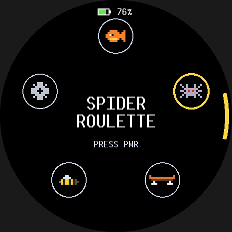
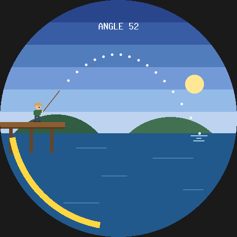
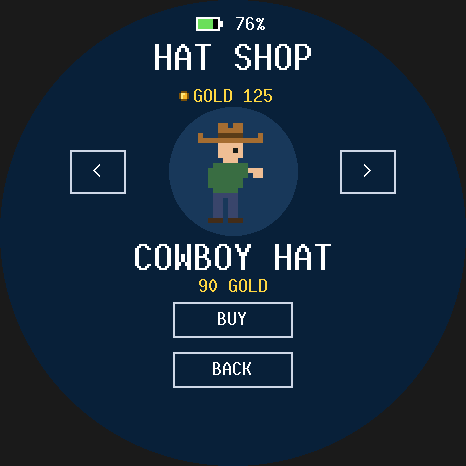
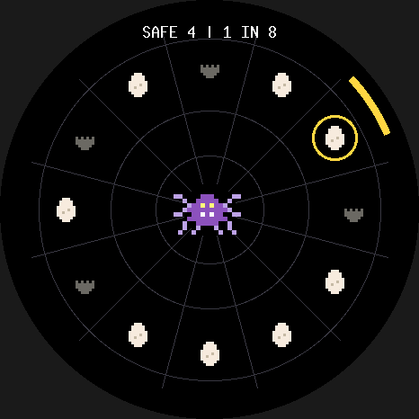

# Orbit board games

`no_std` **Bevy 0.19** games for the Waveshare **ESP32-S3-Touch-AMOLED-1.75**
(466x466 round AMOLED, CO5300 over QSPI, CST9217 touch, QMI8658 IMU, two buttons).
Turning the device like a steering wheel is the main control everywhere; PWR confirms.

- **The arcade** (what the board boots into): turning the device sweeps a dial round the
  rim over ANGLER, SPIDER ROULETTE, SKATE, BEES??? and SETTINGS (sound on/off for every
  game), and PWR picks. Each game's title has HOME to come back.
- **Angler**, a fishing game:
  - **Aim:** turn the device like a steering wheel.
  - **Cast:** a dotted line shows where a full-power cast lands. Hold PWR and release at the
    top of the sweeping meter to land exactly on it; release early and you come up short.
  - **Fight:** lean the device forward and back to keep the fish inside the catch zone, as in
    Stardew Valley.
  - **Keep:** every catch is shown with its length and weight and saved to flash, and pays
    gold by species and size.
  - **Shop:** spend the gold on hats for the angler (beanie, ball cap, cowboy hat, top hat,
    a fish, a crown...). Try them on in the shop's mirror; the one you wear shows on the dock.
    Gold and hats are saved.
  - **Re-level:** BOOT re-zeroes the IMU at any time, and it re-levels by itself after
    each fish.
  - **Battery:** the level shows at the top of the menus, and during play when it's low.
  - **Sound:** effects for the cast, splash, bite, reel clicks, catch, escape, the shop's
    till and menu taps, synthesized by a small script.
  - **Menus:** the title has LOG, SHOP and SETTINGS touch buttons, and MENU on the aiming
    screen goes back to it. Settings has EASY / NORMAL / HARD
    difficulty (saved), RESET (erases the log, gold and hats after a confirm) and **GUTEN**, a riff on logic-fish: a rainbow trout spins to "Guten
    Morgen, Sonnenschein" for 15 s through the board's speaker.
- **Spider Roulette:** twelve eggs ring a web and one hides a spider, which dances in the
  middle. PWR spins a pointer round the ring; it ticks past the eggs, slows, and cracks the
  one it stops on. Each safe egg shortens the odds and quickens the heartbeat; the spider's
  egg pounces. Crack all eleven safe ones to trap it.
- **Skate:** an endless night-street side-scroller. Turn left (nose up) to ollie; in the air
  the board follows your turn, so level out to land. Clear cones; clear benches or land on
  them to grind. The street speeds up. Every 150 m it drops into a halfpipe for a 7 s
  freestyle: air off each wall and turn the device to spin a 180, 360, 540 or 720.
- **Bees???:** the Moon is a hollow jar of honey orbiting the Earth. Something keeps tipping
  it; turn to tip it back before honey pours out (the fuller the jar, the less it takes).
  Bees, wearing the hat from Angler's shop, circle it and fly refills up from Earth.
- **Orbit**, circular pong (touch, its own firmware binary): drag to swing the paddle.
- **Everywhere:** hold BOOT 3 s and the board says GOOD NIGHT and deep-sleeps (panel,
  touch, IMU and amp off); press BOOT to wake. After 30 s untouched the panel dims and the
  loop slows to 20 Hz. Each game's best run persists in its own section of one flash record.

The same Bevy apps run in a desktop simulator and on the board, and both draw
through the same software renderer, so the simulator shows the exact pixels the
panel will get.

  
  

```
crates/orbit_gfx     no_std rasterizer (embedded-graphics + pixel-art sprites), dirty rects, bands
crates/orbit_motion  no_std IMU fusion (Mahony) with zeroing -> steer/lean
crates/orbit_save    no_std power-fail-safe flash records
crates/orbit_audio   no_std PCM clips + mixer (board speaker and desktop audio play the same)
crates/orbit_core    shared Bevy plumbing: frame, touch, rng, save sections, mute; opt-in buttons,
                     tilt, power (battery, sleep, idle), sound
crates/orbit_ui      shared drawing: buttons, battery, sleep overlay, the rotation dial
crates/arcade        the boot menu
crates/angler_game   Angler
crates/spider_game   Spider Roulette
crates/skate_game    Skate
crates/bees_game     Bees???
crates/orbit_game    Orbit
desktop/             minifb simulator for the arcade or any one game + headless PNG snapshots (std)
firmware/            ESP32-S3: board support lib, the arcade binary, and one binary per game
case/                3D-printable fly-reel case (Python/build123d), see case/README.md
```

## How a frame gets to the glass

1. The platform writes the finger position into the `Touch` resource and calls `app.update()`.
2. Game systems produce `Frame { shapes }`: rim ring, labels, paddle arc, ball disc.
3. The `Presenter` diffs the shapes against the previous frame. Only the bounds of
   shapes that changed are redrawn, aligned to even coordinates as the CO5300 requires.
4. Each dirty rect is rendered in 8-row bands into a small internal-SRAM buffer.
   The firmware DMAs each band over quad SPI while the next band renders.

A normal gameplay frame sends about 25 KB, about 1.3 ms of the 40 MHz QSPI link.
A full-screen redraw is 434 KB (about 22 ms) and only happens on screen changes.
`panel_ram_always_matches_a_full_render_of_the_latest_frame` pins that the
dirty-rect path never leaves stale pixels.

## Desktop

```sh
cargo run -p orbit_desktop                              # the arcade (menu -> game -> HOME)
cargo run -p orbit_desktop -- skate                     # or one game: angler spider skate bees orbit
cargo run -p orbit_desktop -- spider snapshot screenshots   # a game's screens as PNGs, headless
cargo test --workspace
cargo clippy --workspace --all-targets && cargo fmt
```

Controls:
- **Mouse:** finger.
- **Space:** the action button (PWR).
- **Z:** the zero button (BOOT).
- **Arrow keys:** ←/→ turn the virtual device like a wheel; it stays turned. Hold ↑/↓ to
  lean it; it springs back level when you let go.
- **C:** straighten the device.

The arrow keys feed a virtual IMU through the same motion filter the board uses.
Desktop saves go to `~/.logic-orbit/<game>.flash`.

The window title shows fps, KB pushed per frame, and the estimated time that
traffic would take on the real link.

## Firmware

### Flashing the board

Plug the board into the Mac with a USB-C data cable, then from the repo root:

```sh
./flash.sh            # the arcade: build, flash, then show the board's serial log
./flash.sh skate      # one game on its own (angler, spider, skate, bees, orbit)
./flash.sh monitor    # reopen the serial log without flashing
```

In the log, Ctrl+C quits and Ctrl+R restarts the board. Every session's log is saved in
`logs/`. Reflashing keeps the board's saves (catches, gold, hats, difficulty). The build
prints a harmless "LOAD segment with RWX permissions" warning.

If flashing fails, the script lists fixes. The usual causes are a charge-only cable, or a
board that won't enter download mode by itself. To force download mode: unplug the board,
hold BOOT (the lower button), plug it back in, release BOOT, and run `./flash.sh` again.
Then unplug and replug the board so it boots the game.

### Building by hand

One-time setup (already done on this machine): `cargo install espup espflash`
then `espup install --targets esp32s3`.

```sh
cd firmware
. ~/export-esp.sh                # every new shell: puts the Xtensa linker on PATH
cargo run --release --bin arcade # build, flash over USB-C, open the serial monitor
cargo run --release --bin orbit  # or any one game: angler spider skate bees orbit
cargo clippy --release && cargo fmt
```

`firmware/` is its own crate with its own `rust-toolchain.toml` (`esp`), outside the
host workspace. It pulls the game crates in by path. Always build it in release
mode; PSRAM needs it, and unoptimized Bevy is far too slow.

### Bring-up checklist (first flash)

The board itself hasn't been run yet; everything below is from Waveshare's
sources plus an emulator run. Run `./flash.sh` and watch the serial log:

1. **`display ready`, then the GONE FISHIN title on the panel.** If the panel stays
   black, the init list in `firmware/src/co5300.rs` is the place to look. It is
   Waveshare's ESP-IDF BSP sequence for this board. Their Arduino demo uses a
   shorter one (`11`, wait 120 ms, `FE 00`, `C4 80`, `3A 55`, `53 20`, `63 FF`,
   `29`, `51 D0`) that is worth trying.
2. **Image shifted or wrapped horizontally:** adjust `COLUMN_OFFSET` (6) in `co5300.rs`.
3. **`bevy app built entirely in internal SRAM`.** If it instead warns that Bevy
   spilled into PSRAM, see Memory below.
4. **Tap LOG on the title and the fish log opens.** If SETTINGS opens instead, flip
   `TOUCH_MIRROR_X` in `firmware/src/lib.rs`; if nothing happens, flip
   `TOUCH_MIRROR_Y`. If the log says `CST9217 touch init failed`, check
   the touch reset pin (below). In Orbit, the paddle should jump to your finger.
5. Every 2 s the log prints frame count, average and worst frame time, bytes
   per frame, and heap use.

Angler adds checks for the IMU direction, the PWR hold, the lean direction, and
saves. See section 9 of `docs/ESP32_PLATFORM.md`. All the fixes are one-line
constants or a mapping function in `firmware/src/lib.rs`.

**1.75 vs 1.75C:** this targets the plain 1.75 (LCD reset GPIO39, touch reset
GPIO40). The 1.75C variant uses GPIO1 and GPIO2 for those two resets.

### Memory

Bevy's own bookkeeping (schedules, per-resource tables) dominates. Measured
with a counting allocator on a 32-bit target, peak heap is 265 KB for Orbit, 204 KB for
Angler, 194 for Skate, 192 for Bees???, 187 for Spider Roulette and 182 for the menu. The
newer games are leaner because they use one phase resource instead of Bevy states. The arcade
drops each app before building the next, so only one is ever in memory.
The firmware gives Bevy about 284 KB of internal SRAM (`INTERNAL_HEAP_BYTES` plus
the 72 KB reclaimed region) and keeps about 74 KB of stack. PSRAM is
registered last, only as a safety net. On the ESP32-S3, atomic
read-modify-write does not work on PSRAM, and Bevy keeps `Arc` counts and
spinlocks on the heap. So keep Bevy's working set internal. Put big plain
buffers (sprites, framebuffers) in PSRAM explicitly with `esp_alloc::ExternalMemory`.

### Checking a change without the board

- `tools/heap32/run.sh` measures the game's heap on a 32-bit target and checks it
  against the firmware's internal-SRAM budget. Run it after adding Bevy plugins,
  systems or resources.
- `tools/qemu-smoke/run.sh` boots each game's firmware runtime in Espressif's QEMU
  with scripted input and prints `SMOKE PASS`/`SMOKE FAIL`. Each game is played by a
  scripted player and its save round-trips through emulated flash; the arcade run goes
  menu -> each game -> HOME twice and fails if the heap creeps between apps.

The full platform handbook is `docs/ESP32_PLATFORM.md`.

### Emulator smoke test notes

Espressif's QEMU (`esp-develop-9.2.2-20260417`, `-machine esp32s3`) was used to boot this
firmware's memory layout, with a stub panel and scripted touch, through
3,000+ frames: title, play, a scored hit, game over, retry. Peak heap stayed
internal (0 B in PSRAM). Three emulator-only workarounds were needed:

- esp-hal's wait on `bbpll_cal_done` has to be patched out, because QEMU never sets it.
- The FPU has to be enabled by hand (espressif/qemu#154: QEMU boots with `CPENABLE = 0`).
- Logging has to go over UART rather than USB-JTAG.

The display and touch protocols can only be proven on the real board.

## Making your own game on this

- Bevy here is `default-features = false, features = ["default_no_std"]`:
  app, ECS, states, time, math, and transform. There is no `bevy_render`,
  `bevy_asset`, or `bevy_log`, and no threads.
- Draw by pushing `orbit_gfx::Shape`s into the `Frame` resource. Add new
  shape kinds in `orbit_gfx/src/shape.rs`, and make `bounds()` tight so moving
  things stay cheap.
- Keep `orbit_game` `#![no_std]`. Use `bevy::math::ops` for trig, because
  `f32::sin` is std-only.
- Watch the heap. Every plugin, schedule, and resource costs a few KB on-device;
  the boot log tells you where you stand.
