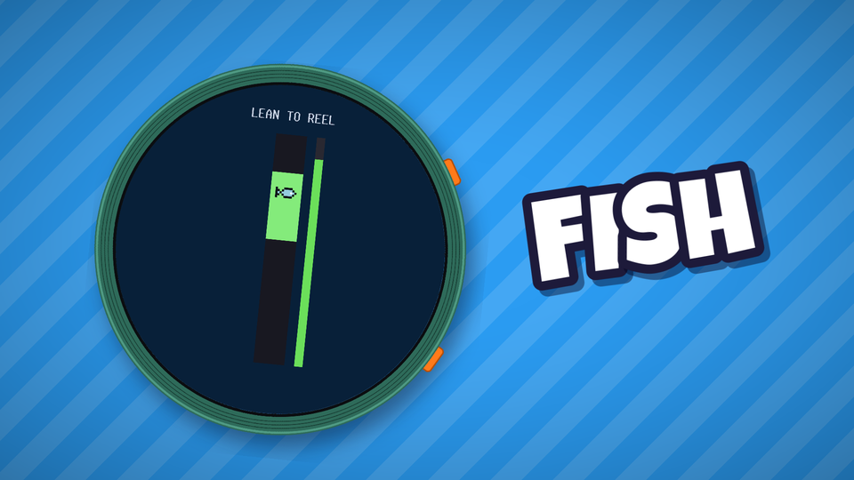
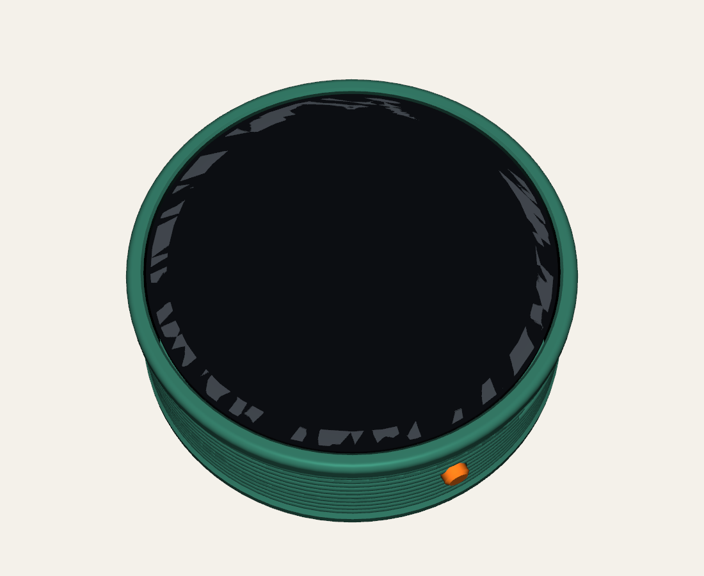
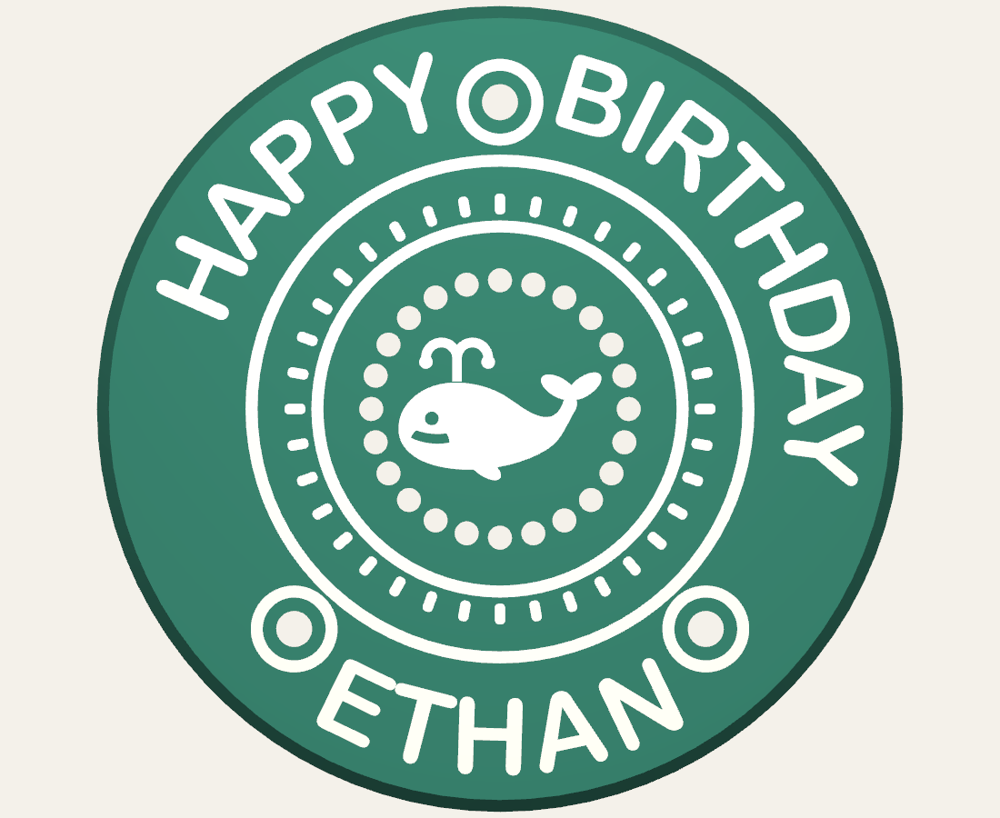
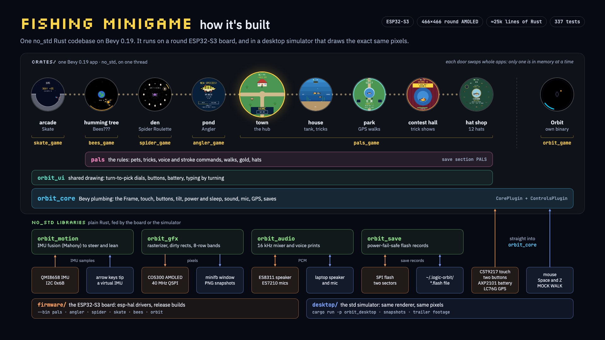
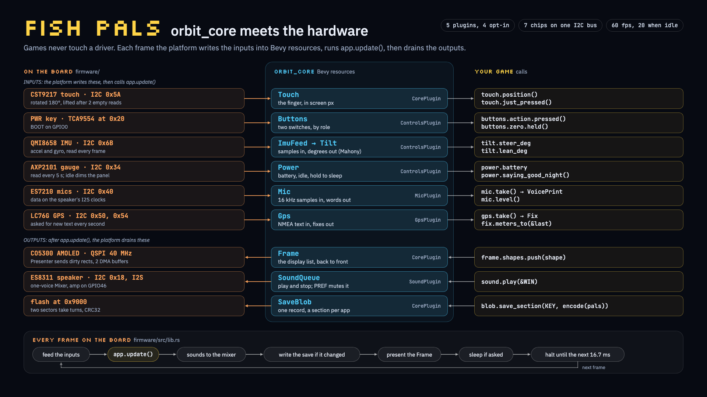
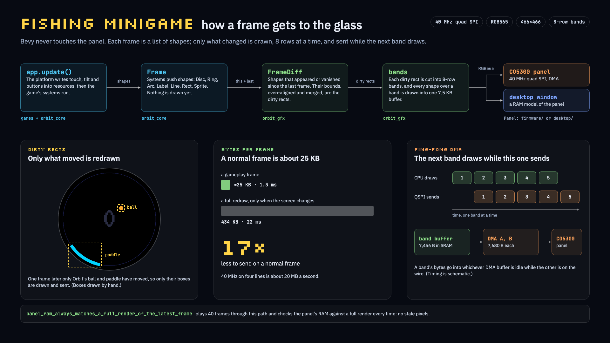
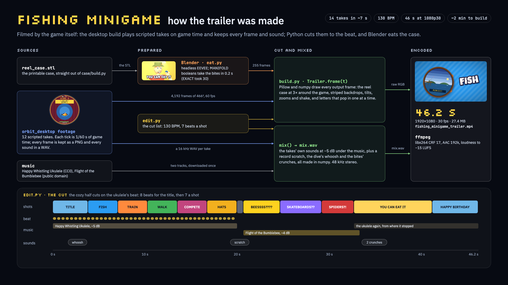
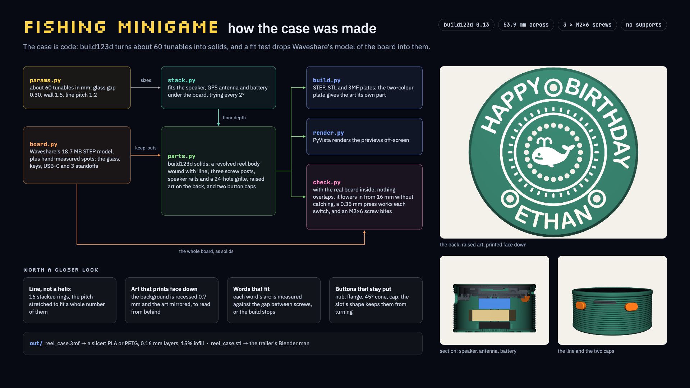

# Fishing Minigame



**A pocket fishing game on a round, watch-sized AMOLED screen, inside a 3D-printed case that
looks like a fly-fishing reel.** Turn it like a steering wheel to cast, lean it to fight the
fish, and keep your best three. Name them, teach them tricks with your voice, walk them with
real GPS, buy them hats and enter them in contests. It's Nintendogs for fish, and it fits in one hand.

Fishing Minigame was made with an AI-first workflow. Claude Code wrote most of the code, the
case model and the trailer pipeline. The developer decided what to build, played every change,
and tested it on the board.

### What you do

- **Walk the town.** Six round clearings joined by paths, with a door at every place. Tap where
  to go, or hold a finger down and you follow it.
- **Fish at the pond.** Turn to aim, hold the upper button and let go at the top of the meter to
  land the cast, then lean forward and back to keep the fish in the catch zone. KEEP a catch
  (or RELEASE it) and name it by turning on a ring of letters.
- **Raise them at home.** Your fish swim in the tank wearing their hats. Each has a card
  (species, size, stamina, appeal) and five tricks, from SPLASH to RAINBOW LEAP. Teach a trick
  by saying a word twice, or by drawing a stroke on the glass twice. Pet the fish right after
  it gets one right, and it learns twice as fast.
- **Walk them in the park.** Walks build stamina. The GPS counts the metres you really walk (not
  standing still, not in a car), and MOCK WALK strolls on its own at up to ×25.
- **Show off at the contest hall.** A 30-second live show. Give your commands as it runs: the
  judges call for tricks, rarer tricks score more, and the top three win gold.
- **Spend it.** The hat shop's ring of 12 hats runs from a beanie to a crown, and the mirror
  shows your fish wearing the one you point at.
- **Play the side games.**
  - Spider Roulette in the den: bet gold on twelve eggs, one of which hides a spider.
  - Skate on the arcade cabinet: a night street, benches to grind, and a halfpipe every 150 m.
  - Bees??? at the humming tree: the Moon is a jar of honey, and you turn to keep it from
    spilling.

Hold BOOT for 3 seconds and it says GOOD NIGHT and switches off. Press the upper button to turn it
back on. Everything you've done is saved.

### What makes it cool

- **You play it by turning it.** An IMU filter turns the board into a steering wheel, and every
  menu is a dial you turn and confirm with a press.
- **Voice commands from voice prints.** Each word you teach becomes a print from seven band-pass
  filters, and the fish gets used to your voice as you use it.
- **A real game engine on a microcontroller.** Every place is a `no_std`
  [Bevy](https://bevyengine.org) 0.19 app that fits in about 284 KB of the ESP32-S3's internal
  SRAM. On the board it runs at 60 fps, with about 6 to 9 ms of work per frame.
- **Only what moved is redrawn.** A normal frame sends about 25 KB to the panel instead of the
  434 KB of a full screen.
- **A simulator with the exact same pixels.** The same apps run on a laptop through the same
  renderer. The screenshots, the tests and the trailer are all the board's real pixels.
- **The case is code.** It's a parametric fly reel in Python (build123d), fit-tested against
  Waveshare's 3D model of the board. It prints support-free, art side down.
- **The trailer was filmed by the game.** Scripted takes play on game time and save every frame
  and sound. Python cuts them to the beat, and a Blender man eats the printed case.

<p align="center">
  
  
  
  
  
  
  
  
  
</p>

## Build and run it

Everything runs from this repo. It was developed on an Apple Silicon Mac.

### What to install

| For | You need |
|---|---|
| The simulator, tests and slides | Rust (stable, edition 2024) via `rustup` |
| The board's firmware | `cargo install espup espflash`, then `espup install --targets esp32s3` |
| The heap check | `rustup target add wasm32-unknown-unknown` and Node |
| The QEMU check | the firmware toolchain (the script downloads Espressif's QEMU itself) |
| The case | [uv](https://docs.astral.sh/uv/) |
| The trailer | uv, ffmpeg and Blender |
| The slides | Python 3 and Google Chrome |

### The desktop simulator

```sh
cargo run -p orbit_desktop                              # Fishing Minigame (town -> a place -> OUT)
cargo run -p orbit_desktop -- home                      # or one app: town home park contest shop
                                                        #   angler spider skate bees orbit
cargo run -p orbit_desktop -- contest snapshot screenshots  # an app's screens as PNGs, headless
cargo run --release -p orbit_desktop -- footage <dir>   # the trailer's takes, every frame + WAV
```

- **Mouse:** finger.
- **Space:** the upper button, which confirms.
- **Z:** the zero button (BOOT). Hold it 3 s to switch off; Space turns the board back on.
- **Arrow keys:** ←/→ turn the virtual device like a wheel; it stays turned. Hold ↑/↓ to lean
  it; it springs back level when you let go.
- **C:** straighten the device.

The arrow keys feed a virtual IMU through the same motion filter the board uses. The laptop's
microphone stands in for the board's mics (macOS asks for access once), and walks use MOCK WALK
from the signpost by the house. Desktop saves go to
`~/.logic-orbit/<mode>.flash`. The window title shows fps, KB pushed per frame, and how long
that traffic would take on the real link.

### Tests and checks

```sh
cargo test --workspace                          # 337 tests
cargo clippy --workspace --all-targets && cargo fmt
tools/heap32/run.sh                             # each app's heap against the board's SRAM budget
tools/qemu-smoke/run.sh                         # every game's firmware, booted in emulation
```

- **`cargo test`:** checks every frame of every game test for crowded text: text touching
  other text, half on scenery, under a shape or off the glass. It also plays each app at random
  with the most crowded data (full tanks of 8-letter names, the tallest hat, a huge purse,
  every trick) looking for more.
- **`heap32`:** measures each app's heap on a 32-bit target. Run it after adding Bevy plugins,
  systems or resources.
- **`qemu-smoke`:** boots each game's firmware runtime in Espressif's QEMU, plays it with
  scripted input and round-trips its save through emulated flash. It prints
  `SMOKE PASS`/`SMOKE FAIL`. The Fishing Minigame run walks through every door and back out
  twice, and fails if the heap creeps between apps.

### Flash the board

Plug the board in with a USB-C data cable, then from the repo root:

```sh
./flash.sh            # Fishing Minigame: build, flash, then show the board's serial log
./flash.sh skate      # one game on its own (angler, spider, skate, bees, orbit)
./flash.sh monitor    # restart the board and show its serial log, without flashing
```

- **In the log:** Ctrl+C quits and Ctrl+R restarts the board. Every session's log is saved in
  `logs/`.
- **Saves:** reflashing keeps the board's saves (your fish, gold, hats and scores).
- **A harmless warning:** the build prints "LOAD segment with RWX permissions".
- **If flashing fails:** the script lists fixes. The usual causes are a charge-only cable, or a
  board that won't enter download mode by itself. To force download mode, turn the board off
  (unplug USB and hold PWR, the upper button, for 10 s), plug USB back in, then hold BOOT (the
  lower button) while pressing PWR. With the battery connected, unplugging USB alone doesn't
  turn the board off.
- **"waiting for download" after flashing:** entering download mode over USB leaves this
  board's ESP32-S3 reading BOOT as held until it loses power, so a plain reset after flashing
  starts the bootloader again. The script restarts the board with a watchdog reset instead,
  which reads BOOT again. That restart skips the first 1.5 s of the log; Ctrl+R shows a full
  boot.

To build by hand:

```sh
cd firmware
. ~/export-esp.sh                # every new shell: puts the Xtensa linker on PATH
cargo run --release --bin pals   # build, flash over USB-C, open the serial monitor
cargo run --release --bin orbit  # or any one game: angler spider skate bees orbit
cargo clippy --release && cargo fmt
```

`firmware/` is its own crate with its own `rust-toolchain.toml` (`esp`), outside the host
workspace. It pulls the game crates in by path. Always build it in release mode, because PSRAM
needs it and unoptimized Bevy is far too slow.

### The case, the trailer and the slides

```sh
cd case && uv run build.py         # ~20 s: print plates (3MF), STL and STEP files in case/out/
cd case && uv run check.py         # ~5 min: fit-test both cases against the board's 3D model
cd case && uv run render.py        # the PNG previews in case/previews/
cd trailer && uv run build.py      # ~2 min: trailer/out/fishing_minigame_trailer.mp4
python3 docs/architecture/build.py # the architecture slides below, as 1080p PNGs
```

`check.py` and `render.py` need Waveshare's 3D model of the board in `docs/`; see
[docs/WAVESHARE_FILES.md](docs/WAVESHARE_FILES.md). [case/README.md](case/README.md) and
[trailer/README.md](trailer/README.md) cover the details.

## Build your own

<p align="center">
  
  
</p>

### Parts

- **The board:** a Waveshare **ESP32-S3-Touch-AMOLED-1.75-G**. It has the 466×466 round AMOLED,
  touch, an IMU, two mics, a speaker amp, a PMIC and the LC76G GPS
  ([Waveshare's hardware reference](https://github.com/waveshareteam/ESP32-S3-Touch-AMOLED-1.75)).
  - The plain **-1.75** works too: walks use MOCK WALK, and the case can be built thinner
    (`GPS_ANTENNA = None` in `case/params.py`).
  - The firmware expects the 1.75's LCD and touch resets on GPIO39 and GPIO40. The **1.75C** puts
    them on GPIO1 and GPIO2.
- **The speaker:** the 8 Ω speaker that comes with the board, plus a little double-sided foam
  tape.
- **Screws:** 3× **M2×6**, pan or socket head (M2×5 also works). Never use anything longer than
  6 mm, because an 8 mm screw reaches the display.
- **A USB-C data cable.** A charge-only cable can't flash it.
- **Filament:** PLA is fine, and PETG gives tougher button caps. A second colour is optional,
  for the line or the back art.
- **Optional, a battery** for the thicker battery case:
  - a single-cell 3.7 V LiPo with a protection circuit, 300 mAh or more, such as a 602030
    (300–400 mAh, about 20.5 × 32 × 6.7 mm);
  - its plug must be **MX1.25 2-pin** (JST-GH looks similar but won't fit);
  - **check the polarity against the + and − marks by the BAT socket before plugging it in**,
    because sellers wire these leads both ways.

  Or skip the battery and use any USB-C power bank.

### Print the case

Run `cd case && uv run build.py` and open a plate from `case/out/`. Use `reel_case.3mf` for the
USB case (53.9 mm across, 24.6 mm tall) or `reel_case_battery.3mf` (31.4 mm tall). Each plate
has three button caps, one of them a spare.

- **Settings:** 0.16 mm layers, 3 walls, 15 % infill, supports and brim off. Everything is already
  lying the way it prints: the case on its back, and the caps on the face you press.
- **A two-tone line:** add a filament change at the two heights `build.py` prints (2.0 and
  22.4 mm for the USB case).
- **A two-colour back:** with an AMS, open the `_two_colour.3mf` plate instead.
- **Make it yours:** the back reads HAPPY BIRTHDAY / ETHAN, because the first one was a present.
  Change `TEXT_TOP` and `TEXT_BOTTOM` in `case/params.py`. The build stops if a word doesn't fit
  between the screws.

`fit_test_ring.stl` is the top 10 mm of the case: a short print to check the glass, USB-C and
buttons before the full one.

### Put it together

1. Push each button cap out through its slot from inside the case until its flange stops it.
   Masking tape over the outside keeps the caps in while you work.
2. Lay the speaker face down between the two rails, with its wire towards the lone post at
   12 o'clock, and plug it into the board's SPK socket.
3. On a -G board, lay the GPS antenna on the speaker, ceramic side down. Plug its lead into the
   U.FL socket nearer the USB-C port (the one by the side buttons is for Wi-Fi).
4. Battery case: stick the cell on top with foam tape and plug it into BAT.
5. Line USB-C up with the big opening and lower the board straight in, glass up.
6. Turn it over and drive the three screws in until snug. Peel off the tape: each cap should
   click its switch.

[case/README.md](case/README.md) has the full guide, including what to adjust if your parts
measure differently.

### Flash it and check it

Run `./flash.sh` and watch the serial log:

1. **`display ready`, then the title on the panel.** If the panel stays black, the init list in
   `firmware/src/co5300.rs` is the place to look.
2. **The image is shifted or wrapped horizontally:** adjust `COLUMN_OFFSET` (6) in `co5300.rs`.
3. **`bevy app built entirely in internal SRAM`.** If it warns that Bevy spilled into PSRAM, see
   Memory below.
4. **Taps land in the wrong place:** flip `TOUCH_MIRROR_X` or `TOUCH_MIRROR_Y` in
   `firmware/src/lib.rs`. If the log says `CST9217 touch init failed`, check the touch reset pin.
5. **Every 2 s** the log prints the frame count, the average and worst frame time, the bytes per
   frame, and heap use.

Most fixes are one-line constants or a mapping function in `firmware/src/lib.rs`.
[docs/ESP32_PLATFORM.md](docs/ESP32_PLATFORM.md) section 9 lists what each game adds to check.

### On the board

Everything in this README runs on the board: every game and place at 60 fps, touch, tilt, both
buttons, voice commands, GPS walks, sound, saves, switching off and on, and battery charging.
The serial logs of real sessions are in `logs/`.

## How it's built

### The stack



- **One Bevy app per place.** Every place is its own `no_std` Bevy 0.19 app, and each door swaps
  whole apps, so only one is ever in memory.
- **The layers:** under the games sit the shared rules (`pals`), shared drawing (`orbit_ui`) and
  the platform plumbing (`orbit_core`).
- **The libraries underneath:** four plain `no_std` libraries do the work. The board and the
  simulator each feed them from their own hardware.

### orbit_core meets the hardware



Games only see Bevy resources. Each frame the platform writes the inputs into them,
calls `app.update()`, then drains the outputs.

- **Opt-in plugins:** the platform powers what an app's plugins ask for: the speaker for an app
  with sound, and the mics for an app that listens.
- **The bus:** on the board, seven chips share one 400 kHz I2C bus, and the display has its own
  40 MHz quad SPI link.

### How a frame gets to the glass



1. The game's systems push shapes into the `Frame`.
2. The `Presenter` diffs them against the last frame. Only the bounds of shapes that changed
   are redrawn, aligned to even coordinates as the CO5300 requires.
3. Each dirty rect is drawn in 8-row bands into a small internal-SRAM buffer.
4. The firmware DMAs each band over quad SPI while the next band draws.

A normal gameplay frame sends about 25 KB, about 1.3 ms of the 40 MHz link. A full-screen
redraw is 434 KB (about 22 ms) and only happens when the screen changes. The test
`panel_ram_always_matches_a_full_render_of_the_latest_frame` pins that the dirty-rect path
never leaves stale pixels.

### How the trailer was made



### How the case was made



### The crates

```
crates/orbit_gfx     no_std rasterizer (embedded-graphics + pixel-art sprites), dirty rects, bands
crates/orbit_motion  no_std IMU fusion (Mahony) with zeroing -> steer/lean
crates/orbit_save    no_std power-fail-safe flash records
crates/orbit_audio   no_std PCM clips + mixer, and voice prints for spoken commands
crates/orbit_core    shared Bevy plumbing: frame, touch, rng, save sections, mute; opt-in buttons,
                     tilt, power (battery, sleep, idle), sound, mic, GPS
crates/orbit_ui      shared drawing: buttons, battery, sleep overlay, the rotation dial and list,
                     typing by turning
crates/pals          Fishing Minigame's state and rules: pets, tricks, gestures, walks, gold, hats
crates/pals_game     Fishing Minigame's places: the town, house, park, contest hall and shop
crates/angler_game   Angler (the pond)
crates/spider_game   Spider Roulette (the den)
crates/skate_game    Skate (the arcade cabinet)
crates/bees_game     Bees??? (the humming tree)
crates/orbit_game    Orbit, circular pong (touch), its own firmware binary
desktop/             minifb simulator (std) for Fishing Minigame or any one app + headless PNGs
firmware/            ESP32-S3: board support lib, the pals binary, and one binary per game
tools/               heap32 (heap on a 32-bit target) and qemu-smoke (the firmware in QEMU)
case/                3D-printable fly-reel case (Python/build123d), see case/README.md
trailer/             the 46 s FISHING MINIGAME trailer, built from filmed takes, see trailer/README.md
docs/architecture/   the slides above: python3 docs/architecture/build.py
```

The game was called Fish Pals at first, and the code keeps that name (`pals`, `--bin pals`, the
`PALS` save key) so saves survive.

### Memory

Bevy's own bookkeeping (schedules, per-resource tables) dominates the heap.

- **Measured peaks:** with a counting allocator on a 32-bit target, peak heap is 265 KB for
  Orbit and 191 to 208 KB for every Fishing Minigame app (Angler's pond is the biggest). The
  newer apps are leaner because they use one phase resource instead of Bevy states.
- **Resources are expensive:** a Bevy resource costs about 64 times its size in heap, so big
  state is boxed.
- **The budget:** the firmware gives Bevy about 284 KB of internal SRAM (`INTERNAL_HEAP_BYTES`
  plus the 72 KB reclaimed region), and what DRAM is left is the stack: 67 KB for Fishing
  Minigame, 69 to 71 KB for one game. PSRAM is registered last, only as a safety net.
- **Why not PSRAM:** on the ESP32-S3, atomic read-modify-write doesn't work on PSRAM, and Bevy
  keeps `Arc` counts and spinlocks on the heap. So Bevy's working set stays internal, and big
  plain buffers (sprites, framebuffers) go in PSRAM explicitly with
  `esp_alloc::ExternalMemory`.

### Making your own game on this

- **Bevy here** is `default-features = false, features = ["default_no_std"]`: app, ECS, states,
  time, math and transform, all on one thread.
- **Drawing:** push `orbit_gfx::Shape`s into the `Frame` resource. Add new shape kinds in
  `orbit_gfx/src/shape.rs`, and keep `bounds()` tight so moving things stay cheap.
- **`no_std`:** keep the game crate `#![no_std]`, and use `bevy::math::ops` for trig, because
  `f32::sin` is std-only.
- **The heap:** every plugin, schedule and resource costs a few KB on the device. The boot log
  tells you where you stand.

### In the emulator

Espressif's QEMU (`esp-develop-9.2.2-20260417`, `-machine esp32s3`) boots this firmware's memory
layout with a stub panel and scripted touch. It needs three emulator-only workarounds:

- esp-hal's wait on `bbpll_cal_done` is patched out, because QEMU never sets it;
- the FPU is enabled by hand (espressif/qemu#154: QEMU boots with `CPENABLE = 0`);
- logging goes over UART rather than USB-JTAG.

The display, touch, mic and GPS protocols can only be proven on the real board.

### Further reading

- [docs/ESP32_PLATFORM.md](docs/ESP32_PLATFORM.md): the platform handbook. It covers pins and
  protocols, the toolchain, the `no_std` Bevy rules, and the render and memory budgets.
- [devlog/beats.md](devlog/beats.md): the story of building it, beat by beat.

## License

Licensed under either of [Apache License 2.0](LICENSE-APACHE) or [MIT](LICENSE-MIT), at your
option.
